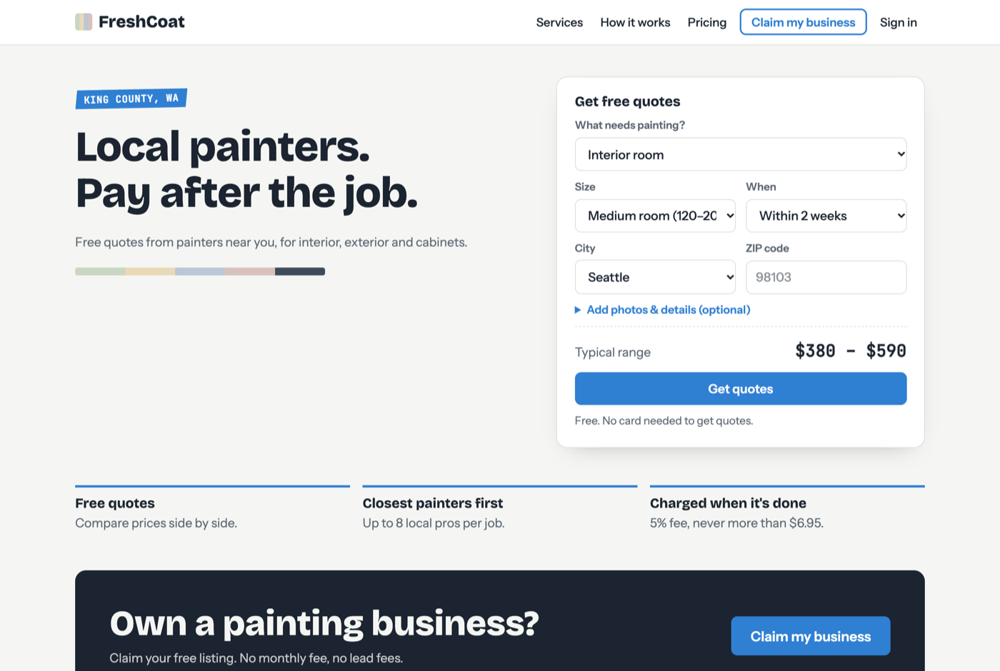
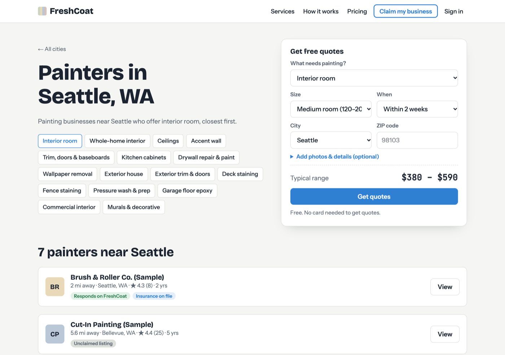
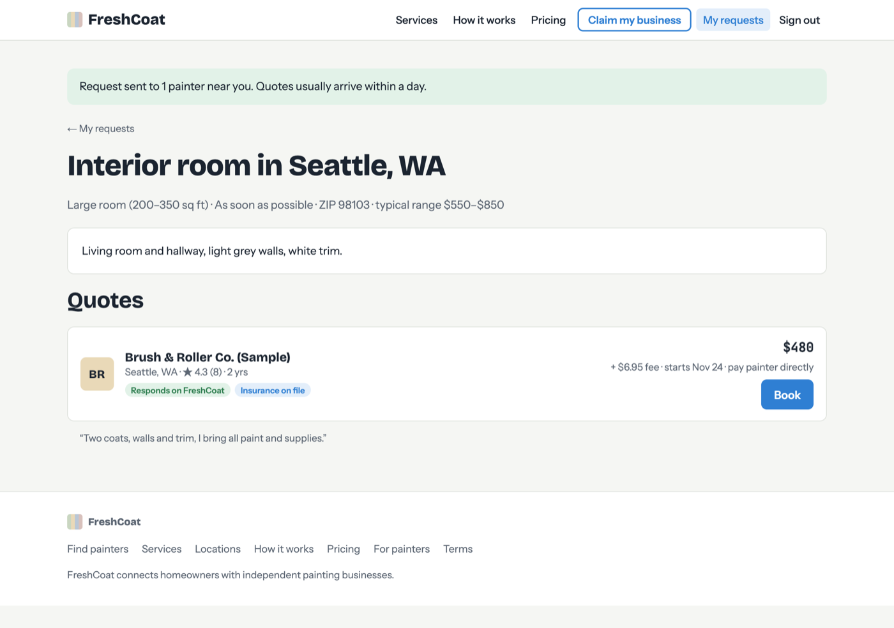
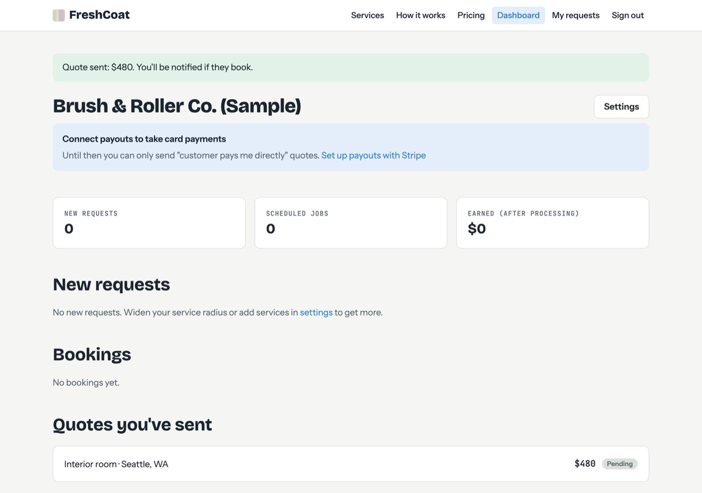
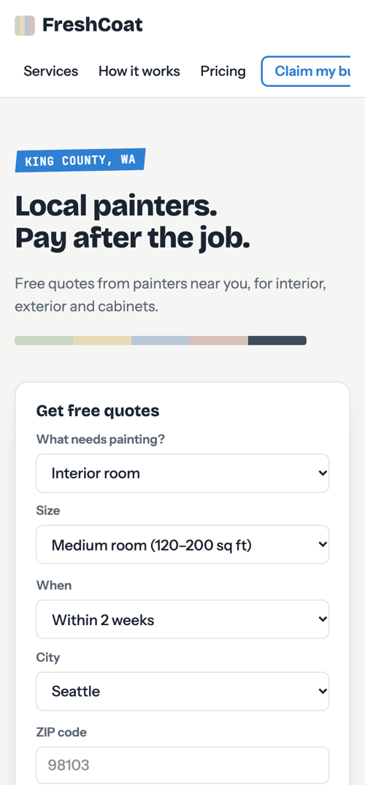

# FreshCoat

**Local painters. Pay after the job.** FreshCoat is a marketplace where homeowners get free quotes from nearby painting businesses, compare them side by side, and are charged only once the job is done.

Laravel 13 · PHP 8.5 · Stripe Connect · Tailwind CSS 4 · Vite · SQLite / MySQL



## How it works

**For homeowners**
1. Pick what needs painting (interior room, cabinets, exterior, deck and 13 more services), the size, the timing and the ZIP code. A typical price range shows up instantly.
2. The request goes to the **8 closest painters** who offer that service. Photos and videos are optional.
3. Compare quotes side by side, then book one. The card is saved at booking and **charged only after the job is marked complete**. Cancel before then and you pay nothing.

**For painters**
- **Claim a free listing** by verifying a 6-digit code sent to the business's phone or email.
- Get matched requests by distance and service radius, then send quotes from a simple dashboard.
- Get paid through **Stripe Connect** payouts, or choose "customer pays me directly" for cash or check.
- No monthly fee and no lead fees. The homeowner pays a service fee of 5%, capped at $6.95.

## Screenshots

<table>
  <tr>
    <td width="50%"><br><sub>City pages list painters by distance (built for local search)</sub></td>
    <td width="50%"><br><sub>A homeowner's request with quotes to compare and book</sub></td>
  </tr>
  <tr>
    <td width="50%"><br><sub>Painter dashboard: requests, bookings, quotes and payouts</sub></td>
    <td width="50%" align="center"><br><sub>Works on phones</sub></td>
  </tr>
</table>

*Every business shown is a fictional "(Sample)" listing from the demo seeder.*

## How it's built

- **Laravel 13** with Blade views, form requests for validation, role middleware for homeowners and painters, and rate limits on sign-in and on claim codes.
- **Matching** (`app/Actions/DispatchQuoteRequest.php`): finds painters offering the service within their service radius and sends the request to the closest 8, measuring distance with the haversine formula in `app/Support/Geo.php`.
- **Payments** sit behind a `PaymentGateway` interface, with a Stripe implementation and a fake one for tests. Stripe Connect handles painter onboarding, the card is saved with a SetupIntent at booking and charged on completion, and a signed webhook keeps payment status in sync.
- **Fees** live in one place (`app/Support/Fees.php`), all in cents.
- **Listing claims** use hashed one-time codes that expire after 15 minutes, sent by text when there's a phone number and by email otherwise. Texting goes through a swappable `SmsSender` interface, which only logs messages for now.
- **Uploads:** up to 6 photos or videos per request, stored privately and only shown to the people involved.
- **SEO pages** for each city and service (`/painters/wa/seattle/interior-room-painting`), limited to launch states set in `config/freshcoat.php` (currently Washington).
- **Tests:** 37 PHPUnit feature and unit tests cover the booking flow, claims, quote requests and public pages.

## Run it locally

```bash
composer install
npm install && npm run build
cp .env.example .env
php artisan key:generate
touch database/database.sqlite
php artisan migrate --seed
php artisan db:seed --class=DemoSeeder   # sample painters, plus homeowner@example.test / painter@example.test (password: "password")
php artisan serve
```

Run the tests with `php artisan test`. Stripe is optional for local use: add `STRIPE_KEY`, `STRIPE_SECRET` and `STRIPE_WEBHOOK_SECRET` to try card payments and payouts.
